# SAR Ship Detection and Segmentation Dataset

A comprehensive Synthetic Aperture Radar (SAR) image dataset for ship and land detection and segmentation with region-based stratification to prevent data leakage.

## Overview

This repository contains two versions of the SAR ship detection dataset:

1. **Original Dataset (`dms_sls`)**: Traditional train/test split
2. **Region-Split Dataset (`dms-sls_split_region`)**: Region-based stratification with inshore/offshore classification

---

## Dataset Comparison

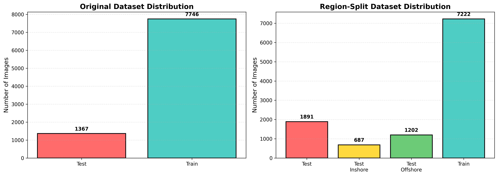

### Original Dataset (`dms_sls`)

- **Total Images**: 9,113
- **Training Set**: 7,746 images (85%)
- **Test Set**: 1,367 images (15%)
- **Annotation Format**: COCO JSON
- **Classes**: Ship, Land
- **Image Size**: 800×800 pixels

### Region-Split Dataset (`dms-sls_split_region`)

- **Total Images**: 9,113
- **Training Set**: 7,222 images (79.2%)
- **Test Set**: 1,891 images (20.8%)
  - **Test Inshore**: 687 images (coastal regions with land+ship)
  - **Test Offshore**: 1,202 images (open sea with ship only)
- **Annotation Format**: COCO JSON
- **Classes**: Ship, Land
- **Regions**: 166 unique geographical locations

---

## Why Region-Based Split?

The region-based dataset addresses a critical issue in geospatial machine learning: **data leakage**.

### Problem with Traditional Split
- Images from the same geographical region may appear in both training and test sets
- Models can memorize region-specific features instead of learning generalizable patterns
- Inflated performance metrics that don't reflect real-world generalization

### Solution: Region-Based Stratification
- Each geographical region's images are exclusively in either training OR test set
- Ensures the model is evaluated on completely unseen geographical areas
- Provides realistic performance estimates for deployment scenarios

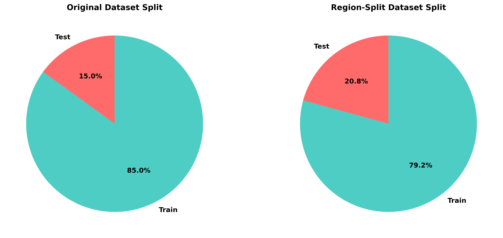

---

## Annotation Statistics

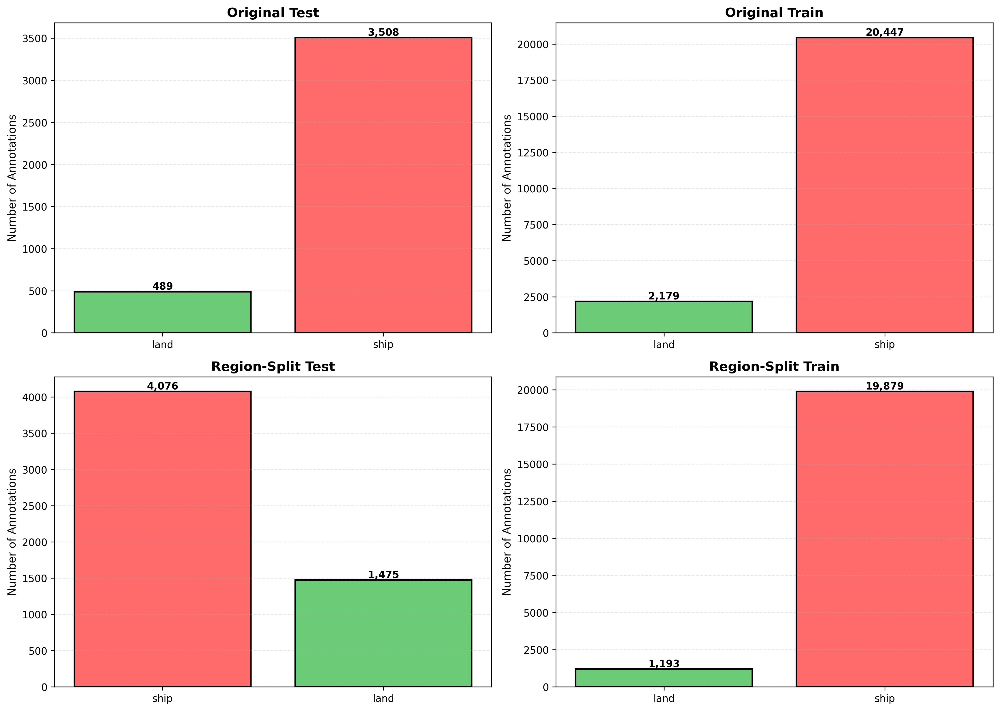

### Category Distribution

| Dataset | Split | Land | Ship | Total |
|---------|-------|------|------|-------|
| **Original** | Train | 9,847 | 12,318 | 22,165 |
| **Original** | Test | 1,832 | 2,626 | 4,458 |
| **Region-Split** | Train | 10,249 | 10,823 | 21,072 |
| **Region-Split** | Test | 3,089 | 2,462 | 5,551 |

### Inshore vs Offshore

The region-split dataset provides specialized test subsets for different maritime environments:

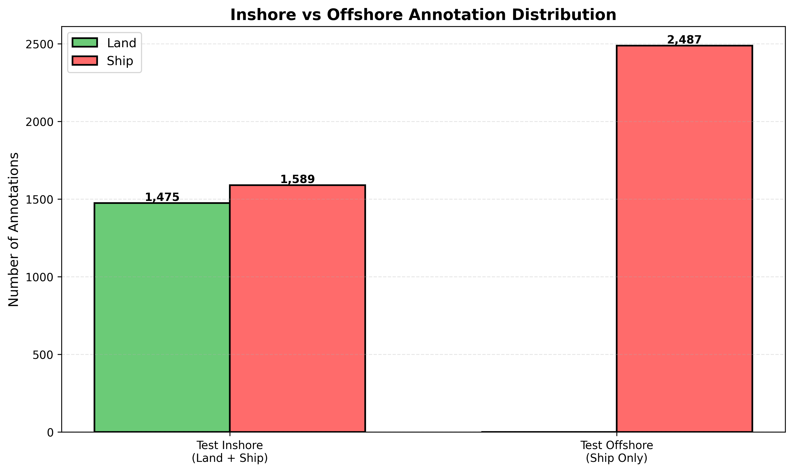

- **Inshore (Coastal)**: 687 images with both land and ship objects, representing complex near-shore scenarios
- **Offshore (Open Sea)**: 1,202 images with ship objects only, representing open-water detection scenarios

---

## Object Size Distribution

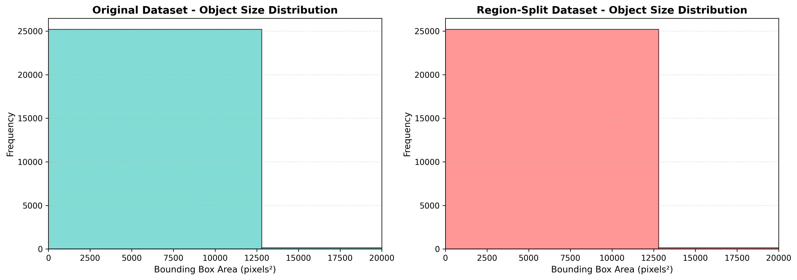

Both datasets maintain similar object size distributions, with most detections ranging from small to medium-sized objects (100-5000 pixels²), reflecting realistic SAR imaging conditions.

---

## Sample Annotations

*Visualization: Green boxes/polygons = Land, Red boxes/polygons = Ship*

### Training Set
<table>
  <tr>
    <td>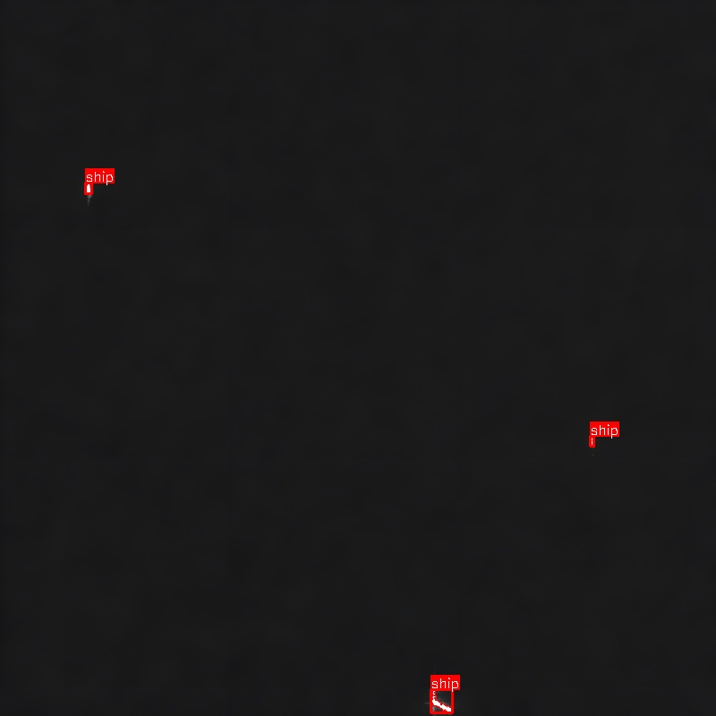</td>
    <td>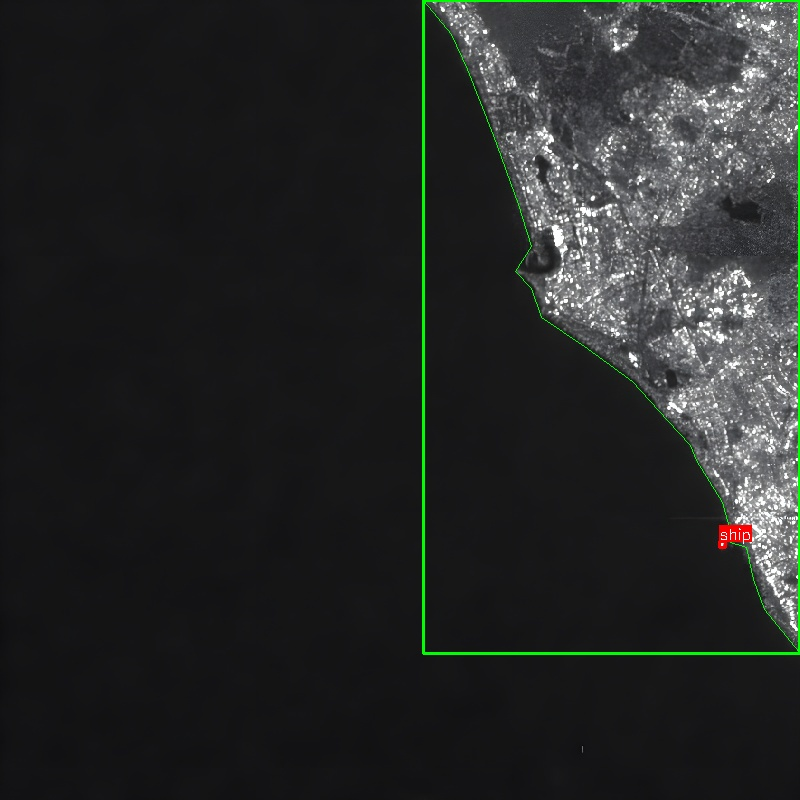</td>
    <td>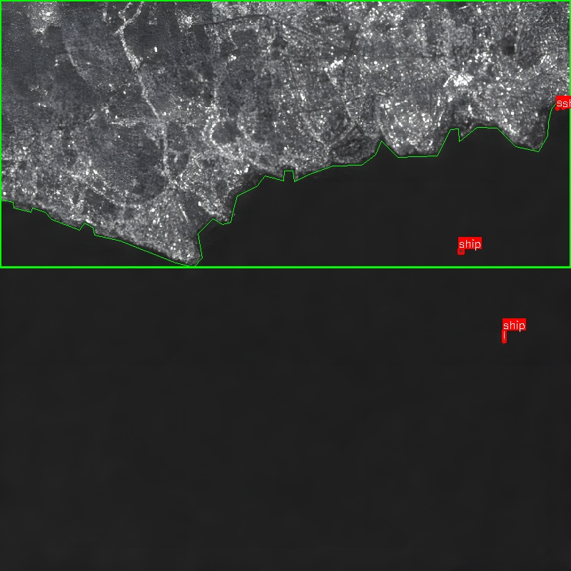</td>
  </tr>
</table>

### Test Set
<table>
  <tr>
    <td>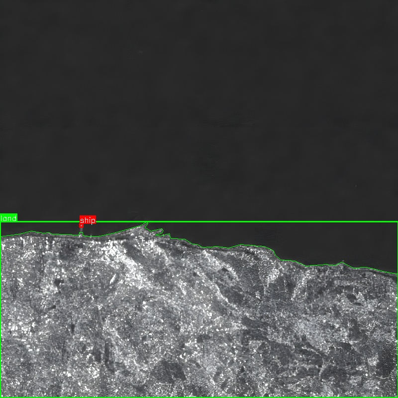</td>
    <td>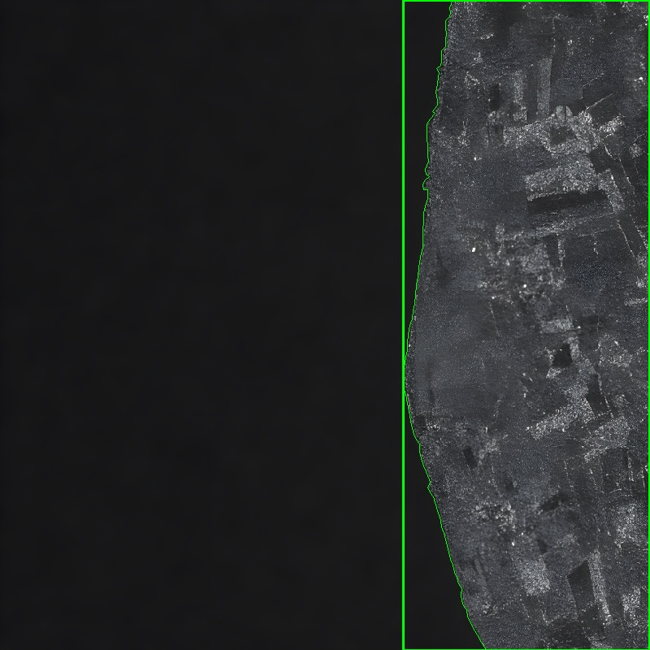</td>
    <td>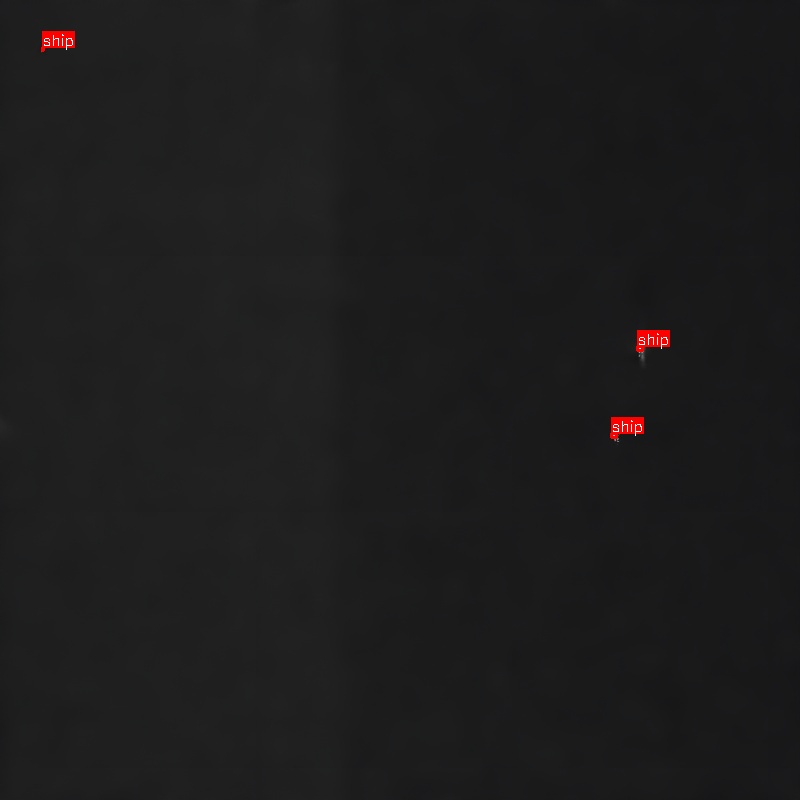</td>
  </tr>
</table>

### Test Inshore (Coastal)
<table>
  <tr>
    <td>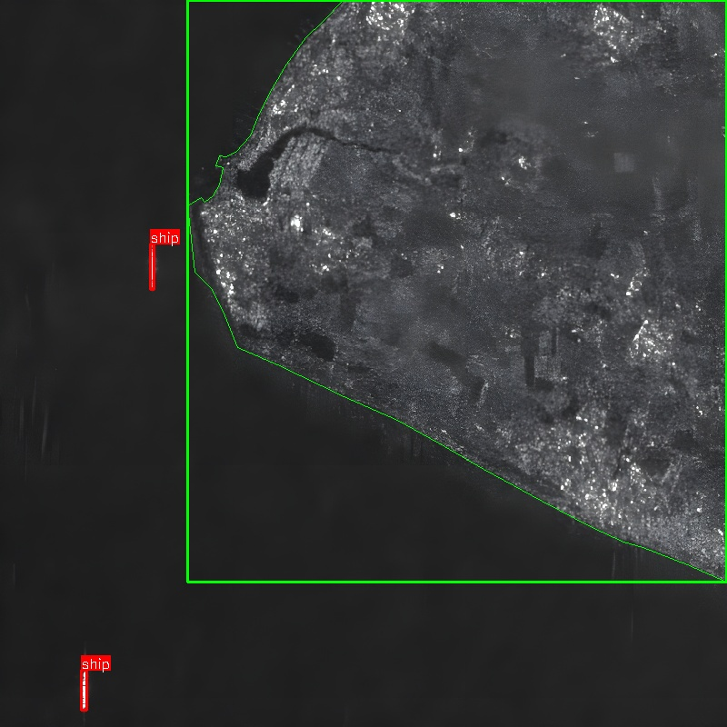</td>
    <td>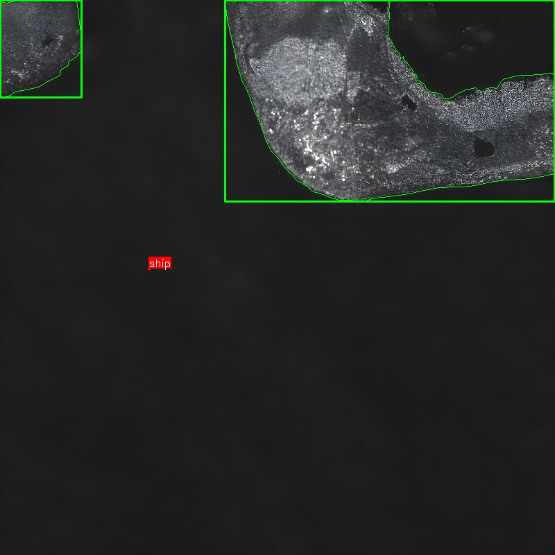</td>
    <td>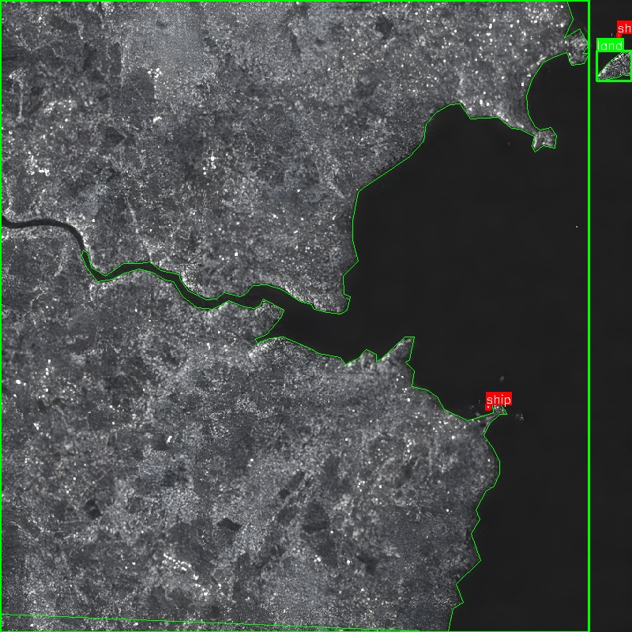</td>
  </tr>
</table>

### Test Offshore (Open Sea)
<table>
  <tr>
    <td>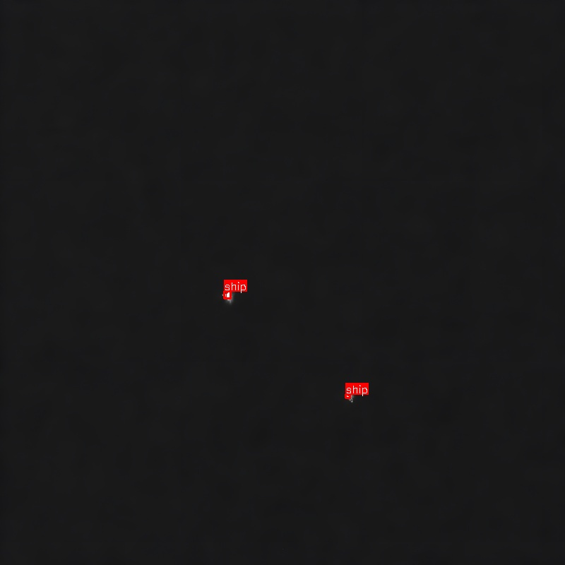</td>
    <td>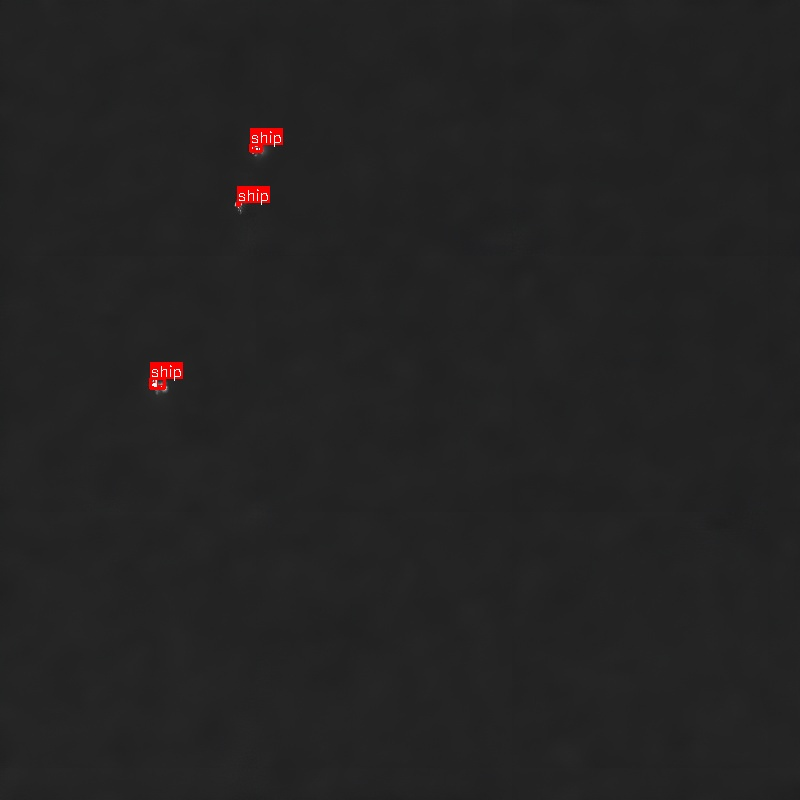</td>
    <td>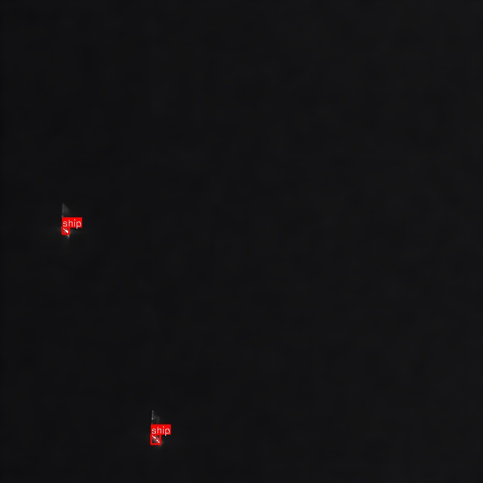</td>
  </tr>
</table>

---

## Dataset Structure

Both datasets share the same directory structure:

```
dataset/
├── annotations/
│   ├── train.json
│   ├── test.json
│   ├── test_inshore.json
│   └── test_offshore.json
└── images/
    ├── train/
    ├── test/
    ├── test_inshore/
    └── test_offshore/
```

---

## Annotation Format

Annotations follow the **COCO format** with both bounding boxes and segmentation polygons:

```json
{
  "images": [{"file_name": "...", "height": 800, "width": 800, "id": 1}],
  "annotations": [
    {
      "id": 1,
      "image_id": 1,
      "category_id": 2,
      "bbox": [x, y, width, height],
      "segmentation": [[x1, y1, x2, y2, ...]],
      "area": 1234.5
    }
  ],
  "categories": [
    {"id": 1, "name": "land"},
    {"id": 2, "name": "ship"}
  ]
}
```

**Filename Format**: `{id}-{Region}{Year}New_v{version}_{x}_{y}_out.jpg`
**Example**: `c51c5224-Dublin2024New_v2_15200_14400.jpg` → Region: Dublin

---

## Usage Recommendations

**For Training**: Use `train.json` from region-split dataset (7,222 images, 160 regions)

**For Evaluation**:
- Overall Performance → `test.json` (1,891 images, 6 regions)
- Coastal Scenarios → `test_inshore.json` (687 images, land+ship)
- Open-Sea Scenarios → `test_offshore.json` (1,202 images, ship only)

**Comparative Studies**: Use original dataset for comparison with prior works; use region-split dataset for rigorous generalization evaluation

---

## Citation

If you use this dataset in your research, please cite the following papers:

### Dataset Paper
```bibtex
@inproceedings{hanbay2024noise,
  title={Noise Reduced SAR Ship Database},
  author={Hanbay, K. and {\"U}zen, H. and {\"O}zdemir, T. B. and Er{\c{c}}elik, {\c{C}}.},
  booktitle={2024 8th International Artificial Intelligence and Data Processing Symposium (IDAP)},
  pages={1--6},
  year={2024},
  organization={IEEE},
  doi={10.1109/IDAP64064.2024.10710785}
}
```

### Application Papers

**CLAHE-Enhanced YOLOv8x for Ship Detection:**
```bibtex
@inproceedings{ercelik2025ship,
  title={Ship Detection in SAR Images Using CLAHE-Enhanced YOLOv8x},
  author={Er{\c{c}}elik, {\c{C}}. and Hanbay, K. and {\"O}zbek, H. C.},
  booktitle={2025 9th International Artificial Intelligence and Data Processing Symposium (IDAP)},
  pages={1--5},
  year={2025},
  organization={IEEE},
  doi={10.1109/IDAP68205.2025.11222185}
}
```

**Channel-Boosted Multi-Scale R-CNN:**
```bibtex
@article{hanbay2026channel,
  title={Channel-boosted multi-scale R-CNN for accurate and real-time ship and land detection in complex SAR scenes},
  author={Hanbay, K. and Alperen {\"O}z{\c{c}}elik, S. T. and Alt{\i}n, M. and {\"U}zen, H.},
  journal={Measurement},
  volume={264},
  pages={120264},
  year={2026},
  publisher={Elsevier},
  doi={10.1016/j.measurement.2025.120264}
}
```

---

*Last Updated: October 2026*
